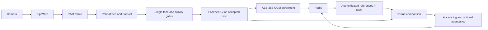

# Local webcam authentication

The teacher desktop records attendance by lecture and issues signed receipts that students can verify independently. The demo runs locally with synthetic students. Live enrollment and attendance use a webcam and Redis.

## Desktop apps

On a fresh checkout, `make setup-demo` installs the synthetic worker without the camera or machine-learning packages. Use `make setup` to add live recognition later. Both modes use the same project virtual environment. From a Fedora graphical session with the desktop packages listed in the desktop guide, start the teacher app:

```bash
/usr/bin/python3 teacher_app.py --demo
```

Use **Enrollment** to add a demo student, **Live class** to open a lecture and mark them twice, then **Register** to finalize it. In **Publication**, export a private receipt and the public register. Launch the separate student verifier and open both files:

```bash
/usr/bin/python3 student_verifier.py --demo
```

The teacher app uses Fedora GTK 4 and a separate worker in the project's Python 3.11 venv. For live sessions, configure the independent school signing identity and run `/usr/bin/python3 teacher_app.py`. The standalone verifier uses Python and cryptography. Its CLI is portable, with optional Tk and Fedora GTK interfaces. Windows and macOS have not been tested. See the [desktop setup, demo and trust model](docs/DESKTOP.md).

## From a face scan to a verifiable receipt

In live mode, RetinaFace locates the face. The teacher worker requires one qualifying face, checks exposure, position and sharpness, and uses FasNet to assess liveness. Facenet512 converts the accepted crop into 512 numbers. The matcher normalizes that vector and compares it with the enrolled templates by cosine similarity. Each student gets the score of their closest template. A unique highest score at or above the cutoff wins. The default cutoff is 0.70. A tie or a lower score yields an unknown result.

A successful scan adds one entry per student per lecture. On finalization, the teacher publishes anonymous commitments and signs their Merkle root with the school's Ed25519 key. A student can use their private receipt and the independently distributed school public key to verify inclusion in that revision offline. The synthetic demo exercises matching and receipt verification using repeatable vectors generated from student IDs.

## Run the checks

| Command | Coverage |
|---|---|
| `make test` | Offline regression tests with synthetic samples and in-memory Redis. |
| `make test-desktop` | Native teacher and student workflows on a private GTK display. |
| `make test-storage` | Concurrent marks, exports, CLI verification and key rotation on a disposable loopback Redis or Valkey server. |
| `make doctor` | Readiness of this installation and its configured services. |

The [bug and verification report](docs/REVIEW_FINDINGS.md) records the results and hardware coverage.

## Fedora setup (Linux x86-64)

Live capture takes the last BGR frame from a 30-frame PipeWire capture, detects faces with RetinaFace and computes a Facenet512 embedding from the accepted crop. A PipeWire failure or 20-second timeout falls back to OpenCV. The camera index applies to OpenCV.

1. Install the host runtime in the same desktop session that can access the camera.

   ```bash
   sudo dnf install python3.11 libglvnd-glx glib2 gstreamer1 pipewire-gstreamer gstreamer1-plugins-good gstreamer1-plugins-base
   gst-inspect-1.0 pipewiresrc
   ```

   Fedora packages the interpreter separately. [Fedora Python 3.11 package](https://packages.fedoraproject.org/pkgs/python3.11/python3.11/)

2. Install Docker Engine and its Compose plugin if needed, and start the daemon. Follow Docker's instructions for your Fedora release and daemon permissions. The commands below assume your shell can run Docker. [Docker Engine on Fedora](https://docs.docker.com/engine/install/fedora/)

   ```bash
   sudo systemctl enable --now docker
   docker compose version
   ```

3. From the project directory, install the pinned dependencies. Existing Phase 2 installations can reuse their virtual environment. FasNet adds PyTorch.

   ```bash
   python3.11 -m venv .venv
   source .venv/bin/activate
   python -m pip install --index-url https://download.pytorch.org/whl/cpu torch==2.6.0
   python -m pip install -r requirements.txt
   pip freeze > requirements.lock
   ```

4. Keep the existing endpoint, database and active key when reconnecting to your enrollments. On a new persistent deployment, provision 32 random bytes in a trusted secret manager and retain them as standard base64. Supply that value without putting it in the command line or a project file. An existing external mode-0600 key file is also supported. For a disposable demo with no persistent key, use the isolated session in [the live test plan](docs/LIVE_TEST_PLAN.md).

   ```bash
   # New installation with a retained secret. Input is hidden.
   read -rsp 'Base64 AES key from secret manager: ' ZKAUTH_KEY && echo
   export ZKAUTH_KEY
   read -rsp 'Redis password: ' REDIS_PASSWORD && echo
   export REDIS_PASSWORD
   docker compose up -d redis
   python main.py list-users
   ```

5. Provision models **before opening the camera** while network access is available. Run as the same user that runs the app. DeepFace caches weights under `~/.deepface/weights`. Prefetch includes both MiniFASNet files. Cached weights are required for offline operation.

   ```bash
   python -m scripts.prefetch_models
   python -m scripts.prefetch_models --check
   python -m scripts.doctor
   ```

6. Set `export ZKAUTH_TIMEZONE=Asia/Kolkata` for a consistent IST demo across hosts. Run `python main.py demo --verbose` to check local capture. Enroll several sharp, centered samples with small pose changes. Existing Phase 2 templates use the same matrix format, embedding model and cosine scoring. Keep a secure backup of the matching key and Redis data.

## Commands

| Command | Effect |
|---|---|
| `python main.py` or `python main.py demo` | Capture, check, encrypt with an ephemeral key and discard the ciphertext. |
| `python main.py enroll alice "Alice Smith"` | Add one template, up to five per user. |
| `python main.py verify alice` | Compare against Alice's templates. Exit 0 for a match, 2 for a below-threshold score, 1 for an error or failed gate. |
| `python main.py identify` | Return the unique best user above or at the cutoff. Unknown and cross-user ties print `unknown` and exit 2. |
| `python main.py identify --loop --interval 2` | Repeat identification until Ctrl+C. Interval is the pause after each attempt. |
| `python main.py attendance [--loop] [--interval SECONDS]` | Identify and mark the winning user once per local calendar day. Unknown exits 2 in one-shot mode. Both status messages show the original event time in UTC and local time. |
| `python main.py attendance-report [--date YYYY-MM-DD] [--csv PATH]` | Show or export ID, name, timestamp_utc and timestamp_local for one local date. The default is today in the attendance timezone. Export uses a new private file (0600). Spreadsheet-sensitive cells receive a leading apostrophe. |
| `python main.py list-users` | Print ID, name, template count and enrollment time. |
| `python main.py logs` | Print the latest 20 access events, newest first, with UTC timestamp, user ID, score when available, and result. |
| `python main.py delete-user alice` | Authenticate Alice's template with the active key, then delete her record and counter. Attendance history survives deletion. Existing audit events age out at the stream cap. |
| `python -m scripts.rotate_key` | Rotate all templates using an independently retained replacement in ZKAUTH_NEXT_KEY. See below. |
| `python -m scripts.calibrate_threshold` | Summarize cosine scores for genuine and impostor pairs among stored templates. Use held-out captures to tune the decision threshold. |
| `python -m pytest -q` | Run offline tests using synthetic data, mocked detection and fakeredis. |

Shared capture and diagnostic flags work before or after the subcommand. Place command-specific flags after the subcommand. Use `--backend gst-pipewire|opencv`, `--camera 0` and `--detector retinaface` to override capture or detection. Use `--no-antispoof` only with an isolated evaluation database. A loop retries sample rejections and active lockouts. A model, storage or configuration error ends the loop with status 1. Ctrl+C exits with status 130. `--verbose` includes numeric quality diagnostics for accepted frames. Application diagnostics go to stderr as JSON with severity levels. Third-party libraries can emit their own messages. CLI results go to stdout.

## Configuration

Python reads exported variables. To load a **trusted** shell-compatible file, run `set -a; source .env; set +a`. Compose reads its environment separately. The application defaults live in `privacy/config.py`.

| Setting | Default | Meaning |
|---|---|---|
| TF_USE_LEGACY_KERAS | 1 | TensorFlow compatibility setting for the pinned DeepFace stack. |
| ZKAUTH_TIMEZONE | system local timezone | IANA name for attendance, for example Asia/Kolkata. Falls back to Asia/Kolkata if the system zone cannot be determined. |
| ZKAUTH_FORCE_CPU | 1 | Set CPU environment defaults before framework imports. Set 0 to use the host environment. |
| CUDA_VISIBLE_DEVICES / TF_CPP_MIN_LOG_LEVEL / TF_ENABLE_ONEDNN_OPTS | -1 / 2 / 1 | Hide GPUs, limit TensorFlow diagnostics and enable oneDNN. Explicit environment settings take precedence. |
| ZKAUTH_CPU_THREADS | physical cores | PyTorch and TensorFlow intra-op parallelism. TensorFlow inter-op uses one thread. |
| ZKAUTH_ANTISPOOF_MIN_SCORE | 0.80 | Inclusive minimum FasNet winning-class probability, in addition to a real verdict. |
| DEEPFACE_HOME | home directory | Parent of .deepface/weights. |
| CAPTURE_BACKEND | gst-pipewire | Capture backend, with OpenCV fallback. |
| ZKAUTH_DETECTOR | retinaface | Supported local detectors are retinaface (TensorFlow), mtcnn and opencv. Only retinaface has operator live evidence. |
| ZKAUTH_ANTISPOOF | 1 | Require FasNet's real-face verdict. Set 0 to disable for testing. |
| ZKAUTH_MIN_CONFIDENCE | 0.95 | Inclusive detector cutoff. Zero-confidence fallback frames always fail. |
| ZKAUTH_MIN_FACE_PX | 100 | Minimum detected width and height in pixels. |
| ZKAUTH_MIN_BRIGHTNESS | 40 | Minimum mean of the full BGR frame on the 0 to 255 scale. |
| ZKAUTH_MAX_BRIGHTNESS | 215 | Maximum mean on the same scale. |
| ZKAUTH_MIN_LAPLACIAN_VAR | 50 | Minimum grayscale Laplacian variance inside the detected box at capture resolution. Higher requires sharper edges. |
| ZKAUTH_MAX_CENTER_OFFSET | 0.25 | Maximum face-center offset from frame center on either axis, as a fraction of that frame dimension. |
| ZKAUTH_THRESHOLD | 0.70 | Inclusive best-template cosine cutoff, greater than 0 and at most 1. |
| ZKAUTH_LOG_CAP | 1000 | Maximum Redis access stream entries, trimmed exactly on append. |
| ZKAUTH_KEY_FILE | unset | External regular file with permissions 0600. Required for matching unless a key is supplied below. |
| ZKAUTH_KEY | unset | Base64 for 32 key bytes. Overrides the key file. |
| ZKAUTH_NEXT_KEY | unset | Replacement base64 AES-256 key for rotation. Supply from a secret manager. |
| REDIS_HOST | localhost | Redis server. |
| REDIS_PORT | 6379 | Host Redis port. |
| REDIS_DB | 0 | Logical database. |
| REDIS_PASSWORD | unset | Required by Compose. Use the existing password when reconnecting. |

All capture commands require exactly one qualifying face before embedding. A missing liveness verdict or a failed quality check rejects the capture. The blur and centering defaults are starting values for live tuning. Enrollment compares the new sample to the user's best existing template. A score above 0.98 warns and still saves the sample. A score below 0.5 refuses it. Five consecutive below-threshold verifications lock the ID for 60 seconds. Capture errors are audited separately. Identification and attendance reject a locked winner and preserve the counter.

## Rotate keys

Stop writers and take a consistent encrypted database backup. Retain both the current and replacement keys in your secret manager before rotation. With the current key active, run:

```bash
read -rsp 'Replacement base64 AES key: ' ZKAUTH_NEXT_KEY && echo
export ZKAUTH_NEXT_KEY
python -m scripts.rotate_key
```

After a confirmed successful commit, configure the replacement key in your secret manager and use it for subsequent commands. For the current shell:

```bash
export ZKAUTH_KEY="$ZKAUTH_NEXT_KEY"
unset ZKAUTH_NEXT_KEY
python main.py verify alice
```

Rotation authenticates the old matrices, verifies staged ciphertext with the replacement, then submits one watched Redis transaction. On disconnect during commit, keep both keys, stop writers, inspect the gallery and verify a known user before resuming. The old key still protects earlier backups.

## Optional app container

`docker compose up -d redis` publishes password-protected Redis on loopback and persists it in a named volume. `docker compose --profile app run --rm --build app list-users` runs a metadata command as a non-root user with a read-only root filesystem, writable tmpfs at /tmp, dropped capabilities and no-new-privileges. The sample app service uses Redis on the internal Compose network. Matching inside a container also requires a readable mode-0600 key mount and provisioned model cache. PipeWire capture needs extra desktop runtime socket mounts, matching permissions and session access. Camera passthrough has not been verified. Use host capture for the documented setup.

See [SECURITY.md](SECURITY.md) for host protections and residual risks.

## Architecture



## Troubleshooting

| Symptom | Check |
|---|---|
| Keras import error | Activate .venv, use the pinned TF and tf-keras versions, set TF_USE_LEGACY_KERAS=1 before launching a fresh process. |
| Fedora IPU6 camera unavailable | Use the host desktop session and gst-pipewire. Check gst-inspect-1.0 pipewiresrc and the session camera permissions. |
| No face detected | Face the camera, improve even lighting, move closer and keep one centered, sharp face in view. Check the confidence, dimensions and brightness diagnostics. |
| Missing torch or FasNet weights | Run the two pip install commands in Fedora setup, then python -m scripts.prefetch_models as the runtime user. |
| Slow first CPU run | Model construction occurs on startup or first use. Use identify --loop to reuse models. Compare warmed timings with python -m scripts.benchmark -n 10. |
| Redis unavailable | Check the endpoint, selected database, exported password and docker compose ps. Run doctor. |

## Project layout

`main.py` handles CLI dispatch. `privacy/` contains capture, model checks, embeddings, matching, encryption, Redis storage and process controls. `scripts/` contains operational and evaluation commands. `tests/` runs offline. See [architecture](docs/ARCHITECTURE.md), [report notes](docs/REPORT_NOTES.md), [live tests](docs/LIVE_TEST_PLAN.md) and [review findings](docs/REVIEW_FINDINGS.md).


## Evidence for the demo

The operator previously exercised PipeWire, RetinaFace, Facenet512, encrypted persistence, cosine matching, the template limit, lockout and the access log. The latest review also exercised the native desktop, a disposable database server, the installed CPU models and synthetic GStreamer capture. Physical-camera accuracy, liveness performance and classroom latency still need live trials. The 0.80 FasNet floor is provisional. See the [ten hardware checks](docs/LIVE_TEST_PLAN.md) and [ranked findings](docs/REVIEW_FINDINGS.md).
